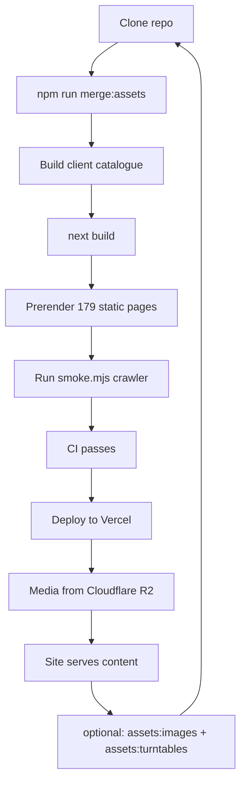

# Porsche 911 Showcase

An unofficial, non-commercial fan showcase of every Porsche 911 generation — nine chapters from the 901 prototype to the 992.2 T-Hybrid era, 164 fully spec'd variants, 179 prerendered routes, a WebGL hero, a scroll-driven timeline, image sequences, 3D and a credits page that names every author and licence.

> **Unofficial fan project.** Not affiliated with, endorsed by, sponsored by or connected to Dr. Ing. h.c. F. Porsche AG or Porsche North America. "Porsche", "911", "Carrera", "Turbo", "GT3" and every badge and logo are trademarks of Porsche AG and are used here only to identify the cars being documented. No Porsche imagery, typeface or marks are reproduced in the site's own design; the site is not affiliated with any Porsche press kit. If you are Porsche AG and want something changed, open an issue.

## Overview

A comprehensive web experience built with Next.js 16, React 19 and Tailwind CSS v4, featuring interactive 3D scenes powered by Three.js, scroll-driven animations with GSAP, and over 1,300 asset records. The site honors every Wikimedia Commons contributor, Sketchfab model uploader and YouTube video creator in a single scrollable credits page.


## Technical stack

| Layer       | Choice                                                                                                                               |
|-------------|-----------------------------------------------------------------------|
| Framework   | Next.js 16 (App Router, React 19, TypeScript strict)                                                   |
| Build       | `next build` (179 static + 4 dynamic routes)                                            |
| Styling     | Tailwind CSS v4 (`@tailwindcss/postcss`), CSS custom-property design tokens                     |
| 3D          | three.js 0.186 · @react-three/fiber · drei · postprocessing (Bloom, DoF, vignette)               |
| Animation   | GSAP + ScrollTrigger, Lenis smooth scroll, framer-motion (route-local only)                     |
| Images      | `next/image` over pre-converted AVIF/WebP produced locally by sharp                                |
| Data        | JSON in `data/`, validated by `data/schema.ts`; slim client catalogue built at build time                        |
| Media       | Cloudflare R2 (public bucket + custom domain) serves the two render trees; committed models/sounds stay local     |
| Type/format | TypeScript 6 (`strict`), ESLint 9 + `eslint-config-next`                                           |
| CI          | GitHub Actions (`.github/workflows/ci.yml`)                                                            |
| Run mode    | Local Next.js server                                                                                 |

## Quick start

```bash
npm install
npm run dev            # http://localhost:3000
```

**Note on media:** The site builds and runs with no media at all: the two render trees (`public/images/**` ~409 MB, `public/turntables/**` ~81 MB) are generated artefacts, not source, so a fresh clone renders the committed silhouette placeholder (`/public/images/_placeholder/911-silhouette.svg`) wherever a real render is missing. Nothing throws and no route 500s — that is by design, not a bug. Both render trees are gitignored (`public/images/**/*` and `public/turntables/**/*`); see [docs/DEPLOY.md](docs/DEPLOY.md) §10.

## Running checks and builds

```bash
npm run check          # merge-assets --check + tsc --noEmit + eslint
npm run build && npm start
node scripts/smoke.mjs http://localhost:3111   # 179-route crawl, needs Playwright chromium
node scripts/test-licence-parse.mjs             # licence parser regression test
```

Node 24 LTS is used by CI. The scripts also run unflagged on Node 26 via native type stripping, which is what the development machine uses.

## Regenerating the assets

The fetch scripts talk to the **Wikimedia REST API** (`api.wikimedia.org`). The Commons Action API host (`commons.wikimedia.org`) is blocked from some networks, including the machine this was built on, and must not be used. The API is rate-limited and answers bursts with `429` + `Retry-After`; every loop already paces itself (`P911_CONCURRENCY`, `P911_GAP_MS`, retry with backoff) — do not "optimise" the pacing away.

```bash
npm run ci:assets                       # the whole pipeline below in one command
npm run assets:images                   # fetch-images --all + convert-images (716 Commons files)
node scripts/convert-images.ts --verify # every referenced render exists on disk
node scripts/fetch-turntables.ts --all  # 103 image sequences (81 MB)
npm run merge:assets                    # fold the manifests into data/generations/*.json
npm run catalog                         # rebuild the slim client catalogue
```

`npm run ci:assets` is fetch → convert → turntables → merge → catalogue, without `next build`. Roughly 10 min for the images and considerably longer for the turntables, all of it network-bound. Useful knobs: `P911_WORK_DIR` (resumable API cache + raw downloads, default `/tmp/opencode/p911`), `P911_CONCURRENCY`, `P911_GAP_MS`, `P911_DOWNLOAD_GAP_MS`, `P911_TT_WIDTH`, `P911_DEBUG=1` (trace every rejected candidate title). `.github/workflows/assets.yml` runs the same pipeline on demand (or weekly) and uploads the result as an artifact — it never commits and never deploys.

`data/generations/*.json`, `data/client-catalog.json` and `data/credits.json` **are** committed; the render trees are not. Anything that writes into `data/` has to be committed for a deploy to see it.

## Serving media from Cloudflare R2

The two big media trees are too large to ship in git (~485 MB across 5 595 files), so they live in a **public R2 bucket** behind a custom domain. `mediaSrc()` in `lib/assets.ts` rewrites `/images/**` and `/turntables/**` to that origin at build time via `NEXT_PUBLIC_MEDIA_HOST`; `next.config.ts` derives the matching `images.remotePatterns` entry from the same variable so the two cannot disagree. Models, sounds and the Draco/Basis decoders stay committed — R2 only carries the two generated trees.

```bash
R2_ACCOUNT_ID=… R2_ACCESS_KEY_ID=… R2_SECRET_ACCESS_KEY=… R2_BUCKET=… \
  npm run assets:upload-r2            # both trees (loads .env when present)
node scripts/upload-r2.ts --dry-run   # preview, no writes
```

Set `NEXT_PUBLIC_MEDIA_HOST=https://content.thetrillioniar.me` on the Vercel project (build-time). Left unset, the paths are returned unchanged and the site keeps serving the committed placeholder — so the env var is a pure upgrade. Full walkthrough, reference values and troubleshooting are in [docs/DEPLOY.md](docs/DEPLOY.md) §10a.

## Deploy to Cloudflare Workers with vinext

This project is configured for deployment to Cloudflare Workers using [`vinext`](https://vinext.dev), which reimplements the Next.js API surface on Vite. Vinext targets 94%+ of the Next.js 16 API and produces a Cloudflare Workers Build Output.

### Prerequisites

1.  **Cloudflare account** with access to create Workers and Bindings.
2.  API token with **Zone > Analytics > Read** and **Zone > Zone > Read** for traffic-aware cache warming.
3.  Install [`cf`](https://github.com/cloudflare/cloudflare-cli) (the init command already added it as a dev dependency).

### Setup (one-time)

```bash
# Initialize vinext for Cloudflare (already done by npx vinext init)
npx vinext init --platform=cloudflare --cdn-cache=response-store --response-store-mode=service-binding --data-cache=kv --image-optimization=cloudflare-images

# Authenticate cf
cf auth login

# Set account ID in cloudflare.config.ts (or CLOUDFLARE_ACCOUNT_ID env var)
# The worker name defaults to "porsche-911-showcase" from package.json
```

### Development

```bash
npm run dev:vinext    # Start vinext dev server on port 3001
```

### Build & Deploy

```bash
# Production build
npm run build:vinext

# Deploy to Cloudflare Workers
npm run deploy:vinext
```

### Cache options

Vinext supports several Cloudflare cache configurations. The init command selected **response-store** (`service-binding` mode) which provides both response and data caching through a separate cache Worker.

### Traffic-aware cache warming

Optionally warm routes covering ~90% of traffic before full promotion:

```bash
npm run deploy:vinext -- --traffic-aware-warm-cache
```

Requires a custom domain (zone analytics unavailable on `*.workers.dev`).

### Media handling with vinext

Vinext's native `@vinext/cloudflare images` optimizer backs `next/image` transformations with a Cloudflare Images binding. Configure in `cloudflare.config.ts`:

```ts
import { bindings } from "cf/config";

env: {
  // ...existing bindings
  IMAGES: bindings.images(),
},
```

Vinext init auto-generated this binding and added the `imagesOptimizer()` to the vite.config.

### Revert to pure Next.js

Your original Next.js setup continues to work alongside vinext. To revert, simply run `next dev` / `next build` and remove the vinext scripts from `package.json`.

Full walkthrough, reference values and troubleshooting are in [docs/DEPLOY.md](docs/DEPLOY.md) §10a.

## Asset summary

| Category | Count | Notes |
|----------|-------|-------|
| **Generations** | 9/9 | 901/F‑body · G‑series/930 · 964 · 993 · 996 · 997 · 991 · 992.1 · 992.2 |
| **Variants** | 164 | Fully spec'd variant records, every one with a cited source set |
| **Routes** | 179 | Home, `/911`, 9 generations, 164 variants (prerendered) + 4 dynamic (`/credits`, `/compare`, `/search`, `/variants`) |
| **Images** | 716 unique Commons files → 2 779 renders (AVIF 640/1280/1920 + WebP 1280), 16 px blur placeholders, **430 MB** | Every variant has a hero **and** ≥5 gallery images except `991/turbo‑gt` (see §4.5); 9/9 generations have hero + timeline images |
| **Video** | 94 YouTube embeds, every ID verified live via oEmbed. Lazy poster facade, never downloaded |
| **3D** | 39 local GLB files (38 MB; 60 of 69 registry references verified by hand, 9 held from the hero) + 70 Sketchfab embeds + 103 image‑sequence turntables (13 real orbits + 90 labelled parallax pans) | The hero auto‑selects only a verified GLB — currently `992‑2/targa‑4‑gts` (2025 Targa 4 GTS) |
| **Sound** | 2 engine recordings (911 R 1967 air‑cooled · 997 GT3 RS water‑cooled), mapped per generation in `data/sounds.json`, played by the "Start the engine" control on every variant hero. Never autoplays into a first visit; attribution ships with the sound |
| **Credits** | 1,314 total asset records (926 images + 82 models + 94 videos + 2 sounds + 210 turntable credits) → auto‑generated, paginated `/credits` page |
| **Hero** | Full‑screen R3F scene: reflective floor, Lightformer studio lighting, Bloom + DoF + vignette, procedural extruded 911 fallback, pointer parallax, scroll‑driven 360° orbit |
| **Timeline** | Pinned GSAP ScrollTrigger sequence, 9 chapters, horizontal year scrub, outlined year numerals, per‑generation accent wash, Lenis smooth scroll |
| **FX library** | 8 drop‑in effects (gradient mesh, speed lines, rain‑on‑glass, heat haze, grain, road tunnel, starfield, **car cursor**), all with reduced‑motion + low‑power fallbacks |

## Build pipeline (mermaid diagram)



## Current lead items (P0‑P3)

### P0 — integrity work still outstanding

- [ ] **Untrack 2 815 turntable frames (81 MB) that are in git.** `.gitignore` has `public/turntables/**/*`, but files already committed stay tracked — ignore rules do not untrack. `.git` is 81 MB for this reason, and every clone/deploy pays for it. `git rm -r --cached public/turntables && git commit -m "untrack generated turntable frames"` (keep `public/turntables/README.md`). Do this only after deciding the deploy story below.
- [ ] **Delete 71 leftover bare‑id image directories (403 MB of duplicates).** Earlier fetch runs wrote `/public/images/carrera/`, `/public/images/turbo‑s/`, … alongside the canonical `/public/images/964/carrera‑4s/` style paths. Both exist; the manifest now uses only the gen‑scoped ones. Safe to delete the bare‑id dirs _after_ confirming with `node scripts/convert-images.ts --verify` that nothing references them.

### P1 — content gaps

#### 3D

- [x] **Verify or drop the 35 GLBs from the 2026‑10‑04 Sketchfab import.** Done 2026‑10‑10: every uid re‑fetched from `api.sketchfab.com/v3/models/{uid}` (licence, author, title, mesh counts); verdicts written into `data/models.json`, 35 provenance credits appended to `data/model‑credits.json` (now 37 entries). 60 of 69 registry references are now `verified: true`; 9 stay held from the hero (over the ≤30 draw‑call budget or low‑poly):
  - gen models `996`, `992‑1`, `992‑2` + variants `991/gt2‑rs`, `996/turbo`, `992‑1/s‑t`
  - The hero therefore resolves to `992‑2/targa‑4‑gts` (2025 Targa 4 GTS, uid `214a61d759e942e2887290b6e4e50d49`, 1.75 MB, CC Attribution 4.0 — title verified against the assignment).
- [x] **Restore the 33 lost Sketchfab `embedUrl` records.** Done 2026‑10‑09: restored in the uid URL form `https://sketchfab.com/3d-models/{uid}?embed=1` (66 records) — Sketchfab 301‑redirects uid URLs to the canonical slug, so the slug table was never needed.
- [ ] **36 variants have no 3D at all** (no GLB, no embed, no turntable). They render the composed "3D coming soon" panel.
- [ ] **90 of 103 turntables are parallax pans of a single photo, not real orbits.** Labelled `turntableSynthetic: true` in the data and disclosed in the viewer UI. Only 13 are genuine multi‑angle same‑car sequences.
- [ ] **Top 10 to shoot for real:** `992‑2/turbo‑s`, `992‑2/carrera‑gts`, `992‑1/gt3‑rs`, `964/carrera‑4`, `997/gt2‑rs`, `991/r`, `997/sport‑classic`, `gseries/turbo‑3.3‑930`, `901/911‑2.0`, `992‑1/s‑t`.
- [ ] **Optional highest‑leverage upgrade: a Sketchfab API token.** Downloads are OAuth‑gated (401 without a token), which is why the pool of open‑licence 911 GLBs is capped at what embeds can show. A 2026‑10‑10 search already found ~12 further stock‑looking 911 candidates not yet held (uids listed in `TODO.md` §3D). That is the single highest‑leverage remaining improvement; nothing else about the pipeline needs to change.

#### Imagery

- [ ] **`991/turbo‑gt` has no hero image and no gallery** — the only variant on the site in that state. Cause: Porsche never published anything about the 2018 Turbo GT, so the search returns nothing era‑accurate. Either drop the variant (it has no specs either) or find one photo with a verifiable caption.
- [ ] **74 variants share a hero photo with a sibling variant** and 33 use a family stand‑in, because Commons has no licensed photo of those trims. Alt text says so ("stand‑in photo (…)”). The images agent also blacklisted 10 Commons files whose photo contradicted its caption (two "1964 Porsche 901" that are 1990s cars, a 964 Turbo Cabriolet presented as the Hebmüller, etc.).
- [ ] **Re‑check the 10 Commons files the images agent blacklisted** still are not referenced anywhere in `data/images.json`.

#### Video

- [ ] **10 variants have no dedicated video** and fall back to their generation's films: `901/{cabriolet‑hembuller, 911‑s‑2.4}`, `gseries/{carrera‑2.7, turbo‑s‑3.3}`, `996/carrera‑4s`, `997/gts`, `992‑1/turbo‑s`, `992‑2/{carrera‑4‑gts, targa‑4‑gts, gt3‑touring}` — no ≥2‑minute verified video exists; only Shorts or unrelated films were found.

#### Data honesty (no code needed, research only)

- [ ] **76 generation‑level + 284 variant‑level `missing[]` notes** are recorded rather than guessed. The notable unresolved ones:
  - `901` **Hebmüller Cabriolet production count** — unverifiable; the widely quoted "130" is flagged do‑not‑publish.
  - Conflicting production totals: Carrera RS 2.7 (1 580 / 1 590), 964 (63 762 / 62 172 / 66 571), 993 (68 881 / 68 029 / 67 535), 997 (213 004 / 215 092), 991 (217 930 / 233 540), 964 Turbo S Flachbau (75/76/90/93), 993 Turbo S (345/336/435)
  - **901‑era 0–100 km/h and kerb weights** — Porsche never published them; only magazine 0–60 figures exist.
  - **992.2 DIN weights** for Carrera Cabriolet / Carrera S Cabriolet / Carrera 4S / Targa 4S (US curb weights used instead)
  - **992.2 GT3 RS does not exist as an announced model** — only camouflaged prototypes (latest spy shots 2026‑09‑23). Its roster entry is kept with `null` specs and a `missing[]` note.
  - **No base 992.2 Carrera 4** — Porsche states the standard Carrera is RWD‑only.
  - **`991/turbo‑gt`** was added as a variant but **every spec field is `null`**: Porsche never published a press release, model page or data sheet for the 2018 Turbo GT, there is no Wikipedia article in any language, and it was never sold in the US. The circulating 645 PS / 3.8 TT / 330 km/h figures are recorded as _unverified context_, not as data. It therefore has **no hero image and no gallery** — the only variant on the site in that state.
- [ ] **`993/gt1`** is included with a `missing[]` caveat that it is arguably not a "911" (mid‑engined GT1). Decide whether it stays.

### P2 — performance debt (all measured; none blocking)

- [ ] **Initial JS is ~1.0 MB** (down from 2.03 MB). Remainder is React/Next runtime + the 160 kB client catalogue + GSAP/Lenis on scroll. Next lever: move the palette index off the main thread or drop framer‑motion from the remaining UI islands.
- [ ] **TBT on `/`** is dominated by three.js parse/execute after the idle callback. No longer blocks LCP, but visible at 4× CPU throttle.
- [ ] **`inlineCss` is enabled but unverified in production** — measured locally (FCP 2044 → 1036 ms on `/compare`), never deployed.
- [ ] **Real‑device WebGL cost is unmeasured.** Every 3D measurement on this box runs on software GL, where the hero deliberately refuses to mount a canvas at all. Needs a check on real hardware.
- [ ] **INP not measured** (only TBT). Lighthouse run‑to‑run variance on this shared 8‑core box is 46–93 perf for identical builds, so use the CDP‑throttled methodology in `docs/perf.md §8`.

### P3 — local verification gaps

- [ ] **No screenshot/visual regression baseline.** A future agent found two content bugs (blurry heroes, a chapter hero clobbered by an unrelated fetch) that every automated check passed. Worth a Playwright screenshot job over the 9 generation pages + a few variants.

### Process notes (learned the hard way — don't repeat these)

- [ ] **`pkill -f "next start"` does not work** — Next renames the process to `next‑server`. Use `pkill -f next‑server` or kill by PID from `ps -eo pid,etimes,cmd | grep next‑server`.
- [ ] **Never run two `next build`s concurrently.** Overlapping builds corrupted `.next` twice and 500'd all 48 gseries pages. Build in the foreground; `rm -rf .next` only when nothing else runs.
- [ ] **Run `merge-assets` before `build-client-catalog`** (both are in `prebuild`, but running them by hand in the wrong order silently ships stale data).
- [ ] **Wikimedia rate limits hard.** A tight 210‑request loop returned 429. Use the cache under `$P911_WORK_DIR` (default `/tmp/opencode/p911`) and throttle; the Commons Action API host (`commons.wikimedia.org`) is blocked from this machine — use `api.wikimedia.org`.

## Documentation

| Doc                                    | What is in it                                                                          |
|--------------------------------------|--------------------------------------------------------------------------------------|
| [TODO.md](TODO.md)                    | **What is left to do**, measured and prioritised (P0 integrity → P3 deploy gaps)       |
| [docs/STATUS.md](docs/STATUS.md)      | What is built, what was verified, known gaps and placeholders, deliberate omissions    |
| [docs/research.md](docs/research.md)  | Sourcing and licence research per generation and per provider; environment constraints |
| [docs/perf.md](docs/perf.md)          | Performance and accessibility audit, measured numbers, open proposals                  |
| [docs/CONTRACTS.md](docs/CONTRACTS.md) | File‑ownership map and the data interchange contracts                                  |
| `/credits`                             | Runtime credits page — every image, model and video with author and licence            |

## How to report issues

The site is an unofficial fan project. For bugs, please open an issue in the GitHub repository. For licence questions, see `docs/research.md` and the credits page.

---

**Last generated:** 2026‑11‑15T13:33:26.314Z (client‑catalog entry)

**License:** All content (images, models, videos, 3D) is licensed under Wikimedia Commons licences (CC BY, CC BY‑SA, CC BY‑NC, CC0, public domain). The site itself carries no analytics, no cookies, no tracking, no ads.